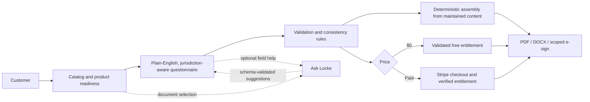

# Locke Direct — Privacy-first, guided legal-document preparation

**Professional legal documents, plain-English guidance, and thoughtful data boundaries — without a subscription.**

[**Explore Locke Direct**](https://www.lockedirect.com) · [**Browse 134 documents**](https://www.lockedirect.com/agreements) · [**Compare pricing and guidance**](https://www.lockedirect.com/pricing) · [**Read the privacy policy**](https://www.lockedirect.com/privacy)

**Built and operated by Locke Development LLC.** This is a **public technical and product reference**, not an open-source copy of the proprietary application. The live site and catalog were inspected **October 31, 2026**; implementation descriptions are maintainer/source-reviewed and are not an independent security certification.

## Why Locke Direct stands out

Locke Direct combines practical legal-document preparation with graduated, plain-English assistance. Customers can complete straightforward forms for **$0**, use more detailed guided interviews when terms require attention, or create coordinated document packages for involved transactions. All four tiers include the applicable document workflow, preview, PDF and editable DOCX deliverables, first-party e-sign capability within product scope, and defined revision access. **No subscription is required.**

The architecture deliberately separates **AI-assisted navigation** from **authoritative legal-document assembly**. Ask Locke helps customers find the right document and understand form fields; validated questionnaires, maintained content, jurisdiction rules, and deterministic assembly control the final output. AI responses are constrained and cannot freely inject operative clauses into signed documents.

## Privacy is an architectural boundary, not an afterthought

- **Browser-local drafts:** questionnaire answers are kept in the browser during draft work; server processing occurs when assembly is requested. Completed paid document content and validated checkout answers are retained where necessary for active access, recovery, and revisions.
- **Marketing analytics separated from private workflows:** only allowlisted public-page measurements are eligible. Questionnaire answers, names, addresses, Ask Locke messages, payments, and document contents are excluded from analytics payloads.
- **Consent-first measurement:** optional marketing analytics requires affirmative consent. Rejection, Do Not Track, Global Privacy Control, or unavailable consent storage block tracking under the documented implementation.
- **Bounded AI requests:** Ask Locke sends voluntarily supplied messages and limited task context through OpenRouter to a selected model provider on zero-data-retention-requested routes; the application does not store Ask Locke chat transcripts on its own servers.
- **Security-focused access controls:** scoped customer sessions, entitlement checks, hashed single-use recovery secrets, signed payment webhooks, safe logging, and defined retention boundaries are documented.
- **Owned outputs:** PDF/DOCX files can be retained and edited by customers; no membership vault is required.

See [Privacy-first architecture](PRIVACY-FIRST.md), [Security architecture](SECURITY-ARCHITECTURE.md), and the governing [live Privacy Policy](https://www.lockedirect.com/privacy). Privacy-first **does not mean zero server processing or zero document retention**; the linked policy specifies what is transmitted and retained.

## Ask Locke — help choosing and completing a document

Ask Locke is a bounded assistance layer with two functions:

1. **Document picker:** a customer describes the intended transaction, and Ask Locke recommends a document that actually exists in the available catalog.
2. **Form guidance:** once a document is opened, Ask Locke can explain field meaning and propose entries from facts the customer explicitly supplies, using only real field identifiers and permitted values.

Recommendations are checked against available catalog slugs; proposed field values are constrained to that document's schema. The assistant can fail safely or return no recommendation rather than inventing a product or legal provision. **Ask Locke is not a law firm, legal advice, or the generator of operative document clauses.**

[Explore guided workflows and Ask Locke](ASK-LOCKE-AND-GUIDED-WORKFLOWS.md) · [Technical AI boundaries](AI-BOUNDARIES.md)

## Four levels of help, transparent one-time pricing

| Level | Live catalog | One-time price | How the workflow helps |
|---|---:|---:|---|
| **Self-Guided** | **24 forms** | **FREE ($0)** | Focused entry of known facts, completeness/consistency checks, one included revision |
| **Customized** | **76 agreements** | **$14.99** | Structured guided questions, selected clauses, detailed terms, consistency checks |
| **Advanced** | **18 documents** | **$24.99** | Issue identification, contingencies, scenarios, cross-clause consistency |
| **Complete Package** | **16 packages** | **$49.99** | Role-aware interviews, coordinated companion documents, cross-document checks |
| **Total** | **134 products** | | |

Each paid tier includes **unlimited revisions for 30 days after purchase**; the free tier includes **one revision**. PDF and DOCX are listed across all tiers, with electronic-signing features subject to their documented scope. A free product is unlocked through the validated $0 entitlement flow rather than a Stripe charge; paid checkout uses Stripe.

Examples include a **free Motor Vehicle Bill of Sale**, a **$14.99 Customized Residential Lease**, a **$24.99 Last Will and Testament**, and a **$49.99 Estate Planning Package**. Product count is not identical to document-file count: packages can contain multiple deliverables.

## What the engineering demonstrates

Design themes: separated pricing/readiness authorities, rule-driven assembly, hierarchical jurisdiction handling, explicit session and payment trust boundaries, synchronized PDF/DOCX rendering, document-package generation, security regression coverage, and deliberately limited AI influence.

## Evidence and documentation

- [System overview](SYSTEM-OVERVIEW.md) · [Document assembly](DOCUMENT-ASSEMBLY.md) · [Jurisdiction model](JURISDICTION-MODEL.md)
- [Privacy-first architecture](PRIVACY-FIRST.md) · [Privacy and data handling](PRIVACY-AND-DATA-HANDLING.md) · [Security architecture](SECURITY-ARCHITECTURE.md)
- [Ask Locke and guided workflows](ASK-LOCKE-AND-GUIDED-WORKFLOWS.md) · [AI boundaries](AI-BOUNDARIES.md)
- [Payments and entitlements](PAYMENTS-AND-ENTITLEMENTS.md) · [Product catalog](PRODUCT-CATALOG.md)
- [Testing and quality](TESTING-AND-QUALITY.md) · [Release verification](RELEASE-VERIFICATION.md) · [Verification records](verification/README.md)
- [Limitations](LIMITATIONS.md) · [Responsible disclosure](RESPONSIBLE-DISCLOSURE.md) · [Changelog](CHANGELOG.md)

**Evidence distinction:** The **134 products and listed prices** are a dated observation of the public catalog on October 31, 2026; the earlier **848 application / 98 security / 376 document passing tests** are dated **August 20, 2026**, for a separate application revision. They are historical evidence, **not a fresh test run or independent audit of today's deployment**. Product availability can change; live catalog pages are authoritative for current offers.

**Proprietary boundaries:** Source code, clause libraries, model prompts, customer records, provider credentials, and exploitable security details are intentionally absent. Technical implementation claims are based on maintainer access to private source and public evidence, not independently reproducible tests from this documentation repository.

**Legal boundary:** Locke Direct provides document-preparation assistance, **not legal advice or legal representation**. Customers must review documents and obtain qualified legal advice for their circumstances.
