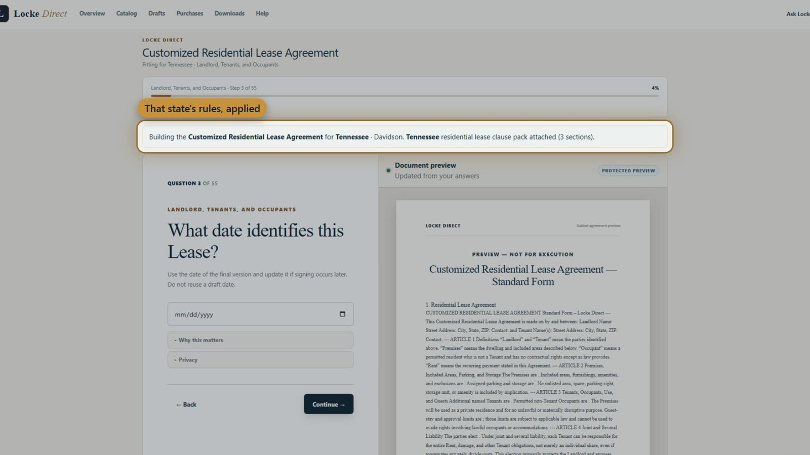

# Locke Direct
### Legal paperwork in plain English. Professional documents. One-time prices.

**Understand what you are signing—not just where to sign.**

Locke Direct is a privacy-conscious legal-document preparation platform for individuals, families, landlords, contractors, freelancers, and small businesses. Choose the document that fits your situation, answer guided questions in everyday language, preview the result, and receive a PDF and editable Word file. No subscription and no trial that automatically converts into recurring billing.

**[Visit Locke Direct](https://www.lockedirect.com/)** · **[Explore documents](https://www.lockedirect.com/agreements)** · **[Pricing](https://www.lockedirect.com/pricing)** · **[Interactive guided tour](https://www.lockedirect.com/demo)**

---

## See Locke Direct in action

**Watch the narrated 1-minute-43-second product demonstration:** from choosing a document and getting help from Ask Locke through a guided interview, preview, checkout, and final downloads.

**[Play the demonstration video](https://www.lockedirect.com/media/locke-direct-demo.mp4)** · **[Explore the step-by-step interactive tour](https://www.lockedirect.com/demo)**

The video is served from the official Locke Direct website; the preview image is included in this public repository. See [DEMO.md](DEMO.md).

## Why people choose Locke Direct

| What matters | The Locke Direct approach |
| --- | --- |
| **Know the cost upfront** | Four published price points: **free, $14.99, $24.99, and $49.99**. Each is a one-time purchase, with no subscription required. |
| **Know what a clause actually does** | Plain-English explanations describe why a question matters, what a term changes, and whose interests it affects. |
| **Get guidance at the right depth** | Start with a self-guided form, progress to customized or advanced interviews, or coordinate related documents in a complete package. |
| **Use AI for assistance, not unchecked legal text** | Ask Locke helps select documents and explains fields; validated inputs and maintained clause content govern final assembly rather than free-form AI drafting. |
| **Keep private work out of marketing analytics** | Marketing measurement is consent-based and restricted to public pages; questionnaire answers and document contents are excluded from analytics payloads. |
| **Leave with files you control** | PDF and editable DOCX outputs; supported electronic-signature workflows and defined revision access. |

### Four levels of help, with straightforward pricing

| Level | One-time price | Designed for |
| --- | ---: | --- |
| **Self-Guided** | **$0** | Straightforward forms when you know the essential details; includes one revision. |
| **Customized** | **$14.99** | Agreements that need structured questions, selected terms, and consistency checks. |
| **Advanced** | **$24.99** | More involved decisions, alternatives, contingencies, and issue-identifying interviews. |
| **Complete Package** | **$49.99** | Related documents coordinated through role-aware questions and shared facts. |

**Paid products include unlimited revisions for 30 days after purchase.** Final deliverables and electronic-signature capability depend on each product's published scope.

## What can you prepare?

- **Property and renting:** residential leases, notices, renewals, and property-related agreements.
- **Sales and transfers:** vehicle bills of sale, private-sale documents, and transaction records.
- **Family and estate planning:** wills, powers of attorney, healthcare authorizations, and coordinated packages.
- **Independent work and business:** contractor agreements, service contracts, nondisclosure agreements, and related documents.
- **Loans and disputes:** promissory notes, demand documents, and settlement-related paperwork.

**[Browse the current catalog](https://www.lockedirect.com/agreements)** — the live site is authoritative for product availability.

## What makes Locke Direct different from other document services?

The strongest distinction is the **combination** of transparent one-time pricing, graduated guidance, an AI assistant limited to navigation and form help, deterministic document assembly, and consent-first marketing analytics.

Competing services can also offer one-time documents, state-specific templates, and Word/PDF exports; those capabilities alone are not unique. The practical decision is how much help you need understanding the terms, how the final document is assembled, and whether you want a recurring plan.

See **[Why Choose Locke Direct? — Five-competitor side-by-side comparison](COMPARISON.md)** for a source-linked, customer-ordered review of **Ask Locke document recommendations and form help**, customizable drafting, revision terms, pricing, and delivery against **LawDepot, eForms, LegalTemplates, US Legal Forms, and LawDistrict**.

## How it works

1. **Choose:** Start with your situation or ask Locke to help identify a suitable document.
2. **Answer:** Work through the document's plain-language questions and relevant jurisdiction choices.
3. **Review:** See the proposed terms and preview the document before completing a purchase.
4. **Finish:** Complete the free entitlement or one-time checkout, then download your documents.

## Built with privacy and control in mind

Locke Direct separates optional public-page analytics from document-preparation workflows. AI-assisted navigation is distinct from the controlled clause-assembly process. Purchases and downloads use server-side entitlement and access checks. The [Privacy Policy](https://www.lockedirect.com/privacy) governs actual processing, retention, and deletion.

**Want to see how the product is engineered?** The [technical reference](TECHNICAL-REFERENCE.md) and documentation in this repository describe system architecture, data handling, verification practices, and limitations without publishing proprietary application code.

---

**[Open Locke Direct](https://www.lockedirect.com/)** · **[Watch the demo](https://www.lockedirect.com/media/locke-direct-demo.mp4)** · **[View pricing](https://www.lockedirect.com/pricing)** · **[Read the privacy policy](https://www.lockedirect.com/privacy)**

Locke Direct is operated by Locke Development LLC. It provides legal-document preparation assistance, not legal advice or representation. Product suitability and legal requirements depend on the facts and jurisdiction; obtain qualified legal advice when needed. This is a product showcase and public reference, not the application's source repository.
