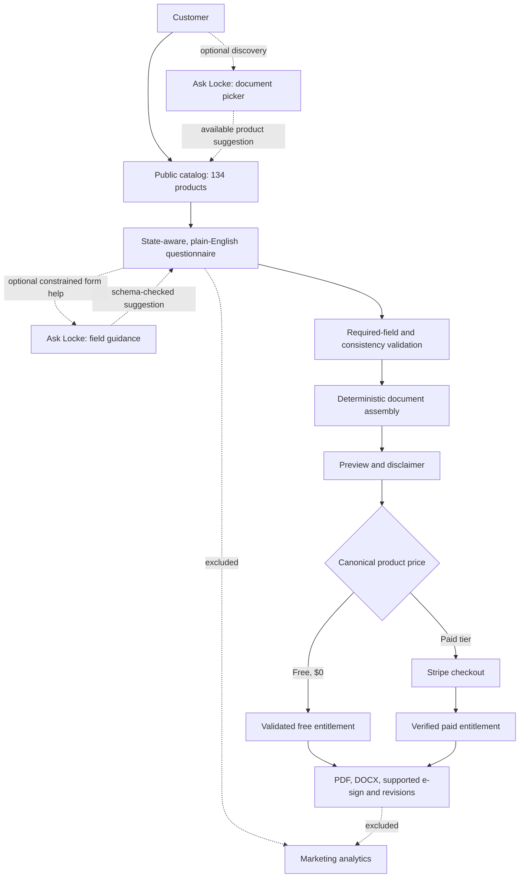

# Locke Direct — current public workflow diagram

**Dated public catalog/pricing observation:** October 31, 2026. This high-level flow omits private routes, secrets, and internal infrastructure detail.

Marketing analytics runs only in a separately gated public marketing context, with affirmative consent and an allowlisted query-free pageview contract; private document and Ask Locke content are not eligible analytics events.

[System overview](../SYSTEM-OVERVIEW.md) · [Privacy-first architecture](../PRIVACY-FIRST.md) · [AI boundaries](../AI-BOUNDARIES.md).
